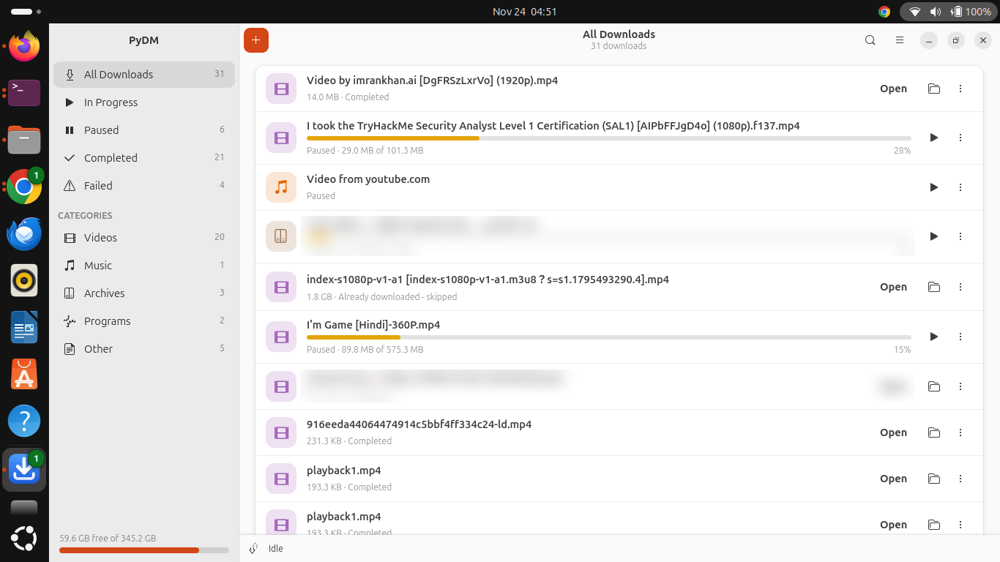
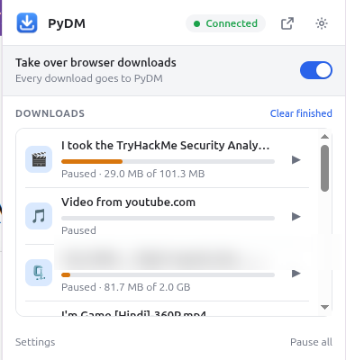

# PyDM — Download Manager for Linux

PyDM is an IDM-style download manager for Linux. It downloads files over several connections at once,
resumes after crashes or a lost connection, grabs videos from YouTube, TikTok, Instagram and
1000+ other sites, and takes over Chrome's downloads with its browser extension.

It is written in plain Python (standard library only) with a native GTK4 / libadwaita desktop app.





---

## Features

**Downloads**
- Multi-connection (segmented) downloads with dynamic re-splitting: idle connections help finish slower parts
- Resumes **exactly where it stopped** after a crash, power loss, `kill -9` or a reboot
- Network-drop handling: retries in place, then waits for the internet to come back and continues automatically
- Smart error handling: temporary errors (timeouts, 5xx, connection reset) are retried with backoff;
  permanent ones (404, unsupported URL) fail right away with a clear message
- Queue with a parallel-download limit, a global speed limit, a per-download start time and a daily time window
  (e.g. "only download 01:00–07:00")
- Never overwrites: a second `report.pdf` is saved as `report (1).pdf`

**Video**
- Video and audio from YouTube, TikTok, Instagram, Facebook, X/Twitter, Reddit, Vimeo and many more (via yt-dlp)
- Quality picker (2160p … 144p) or **Audio only (MP3)**
- Prefers H.264 + AAC so files play in every player
- Uses your browser login only when a site needs it (private or age-restricted posts)
- Detects the raw video stream (mp4 / m3u8 / mpd) on sites yt-dlp doesn't support

**Organized files**: finished downloads are sorted by type inside your download folder:

| Folder | File types |
|---|---|
| `Videos/` | mp4 mkv webm avi mov … |
| `Music/` | mp3 m4a flac wav ogg … |
| `Documents/` | pdf docx xlsx pptx txt epub … |
| `Archives/` | zip rar 7z tar gz iso … |
| `Programs/` | deb rpm AppImage exe apk sh … |
| `Images/` | png jpg gif webp svg … |
| `Other/` | everything else |

You can turn sorting off in Preferences. **Tidy Up** moves older PyDM downloads into these folders. It never touches files PyDM didn't download.

**Desktop app**
- Sidebar filters (All, Downloading, Completed, Failed, and each file type) with counts, plus free disk space
- Live progress, speed and time left; an IDM-style progress window for each download
- Add dialog that detects video links automatically, with a quality picker and scheduling
- Notifications, drag-and-drop links, clipboard monitor, light and dark themes
- Keeps running in the background when the window is closed. Optionally starts at login.

**Chrome extension**
- **Takes over every Chrome download** and sends it to PyDM. If PyDM can't fetch a file (expired link,
  blocked site), Chrome downloads it as usual.
- "Download video" button over videos on supported sites
- Right-click: *Download with PyDM*, *Download this video with PyDM*
- Toolbar popup: connection status, takeover on/off switch, quality chips for the current page's video,
  media detected on the page, and live downloads with pause and resume
- Pairs with PyDM automatically, so there's no token to copy

---

## Install

```bash
sudo apt install python3-gi gir1.2-gtk-4.0 gir1.2-adw-1 ffmpeg   # Ubuntu / Debian
./install.sh
```

The installer:
- copies PyDM to `~/.local/share/pydm`, and yt-dlp into its own virtualenv (`~/.local/share/pydm-venv`)
- sets up the background service `pydm.service` (systemd user service, starts at login)
- adds **PyDM** to your app menu
- adds the `pydm` (command-line downloader) and `pydm-gui` commands to `~/.local/bin`

Re-running `./install.sh` updates PyDM and yt-dlp. It doesn't restart the service while downloads are running;
use `FORCE_RESTART=1 ./install.sh` to restart anyway.

### Browser extension (Chrome, Chromium, Brave, Edge)

1. Open `chrome://extensions` and turn on **Developer mode**
2. Click **Load unpacked** and select `~/.local/share/pydm/extension`
3. Done. The extension connects to PyDM by itself. After updating PyDM, click **Reload** on the extension card.

Firefox is not supported.

### Uninstall

```bash
./uninstall.sh            # remove the app and service, keep settings and download history
./uninstall.sh --purge    # also delete ~/.config/pydm
```

---

## Usage

- **App:** open *PyDM* from the app menu. Press `Ctrl+N` to add a download, or drop a link on the window.
- **Browser:** download anything in Chrome as usual, and PyDM takes over. On a video page, use the
  on-page button or the toolbar popup.
- **Web view:** go to <http://127.0.0.1:6800/>.
- **Command line** (uses the engine directly, without the service):

```bash
pydm URL                          # download into the current folder
pydm URL -c 16 -d ~/Downloads     # 16 connections, choose the folder
pydm -i links.txt --limit 2M      # one URL per line, cap at 2 MB/s
pydm URL -o name.iso -H "Cookie: a=b"
```

| Shortcut | Action |
|---|---|
| `Ctrl+N` | Add download |
| `Ctrl+F` | Search |
| `Ctrl+O` | Open download folder |
| `Ctrl+,` | Preferences |
| `Ctrl+W` / `Ctrl+Q` | Close window (PyDM keeps running in the background) |
| `Ctrl+?` | Show all shortcuts |

To stop PyDM fully, open the main menu and choose **Quit PyDM Completely**.

### Service commands

```bash
systemctl --user status pydm      # is it running?
systemctl --user restart pydm
journalctl --user -u pydm -f      # live log
```

---

## Configuration

Most settings are in **Preferences** in the app. They are stored in `~/.config/pydm/`:

| File | Contents |
|---|---|
| `config.json` | download folder, connections (8), parallel downloads (3), speed limit, time window, sorting, clipboard |
| `jobs.json` | download list and history |
| `token` | secret the extension and app use to talk to the service |
| `ui.json` | desktop app preferences (notifications, popups, background mode) |

Extension settings (takeover, minimum file size, excluded sites and file types, video button) are on
its **Options** page.

---

## How it works

```
Chrome extension ──┐
Desktop app (GTK) ─┼──► pydmd.py  (service on 127.0.0.1:6800)
Web view ──────────┘       ├─ pydm.py  → segmented HTTP downloads (.part + .pydm resume state)
                           └─ yt-dlp   → video sites (+ ffmpeg to merge/convert)
```

| File | Role |
|---|---|
| `pydm.py` | download engine and CLI: segments, retries, speed limit, crash-safe resume state |
| `pydmd.py` | service: queue, scheduler, auto-retry, connectivity watch, video, file sorting, HTTP API, web view |
| `pydm_app.py` | GTK4 / libadwaita desktop app |
| `ui.html` | browser-based web view |
| `extension/` | Chrome MV3 extension (download takeover, video button, media sniffer, popup) |
| `install.sh` / `uninstall.sh` | per-user install and removal (no root needed) |

**Run without installing** (for development):

```bash
python3 pydmd.py              # service + web view at http://127.0.0.1:6800/
python3 pydm_app.py           # desktop app
python3 pydmd.py --port 6801  # different port
```

---

## Security

- The service only listens on `127.0.0.1`, so other computers can't reach it.
- Every API call needs the secret token. The `Host` and `Origin` headers are checked, which blocks other websites.
- Only `http` and `https` URLs are accepted.
- Clipboard links are never started automatically; you start them yourself.
- Browser cookies are written to a temporary file readable only by you (`chmod 600`) and deleted after use.
- Config files are `chmod 600`.

---

## Troubleshooting

| Problem | Fix |
|---|---|
| Extension says **Not running** | Open PyDM from the app menu, or `systemctl --user restart pydm`, then click *Reconnect* |
| "Requested format is not available" | Update yt-dlp: re-run `./install.sh` |
| Instagram or private video fails | Log in to the site in Chrome, then download again from that tab |
| Video downloads without sound or won't merge | Install `ffmpeg` |
| A site's downloads shouldn't go to PyDM | Add the site under extension **Options → Never take over from these sites** |
| Changes to the code don't show up | Re-run `./install.sh`, quit PyDM completely (menu → *Quit PyDM Completely*) and reopen it |

## Contributing

Contributions are welcome. See [CONTRIBUTING.md](CONTRIBUTING.md) for ideas to start with, such as Firefox extension support and .deb / AppImage packaging.

## License

PyDM is released under the [MIT License](LICENSE).
